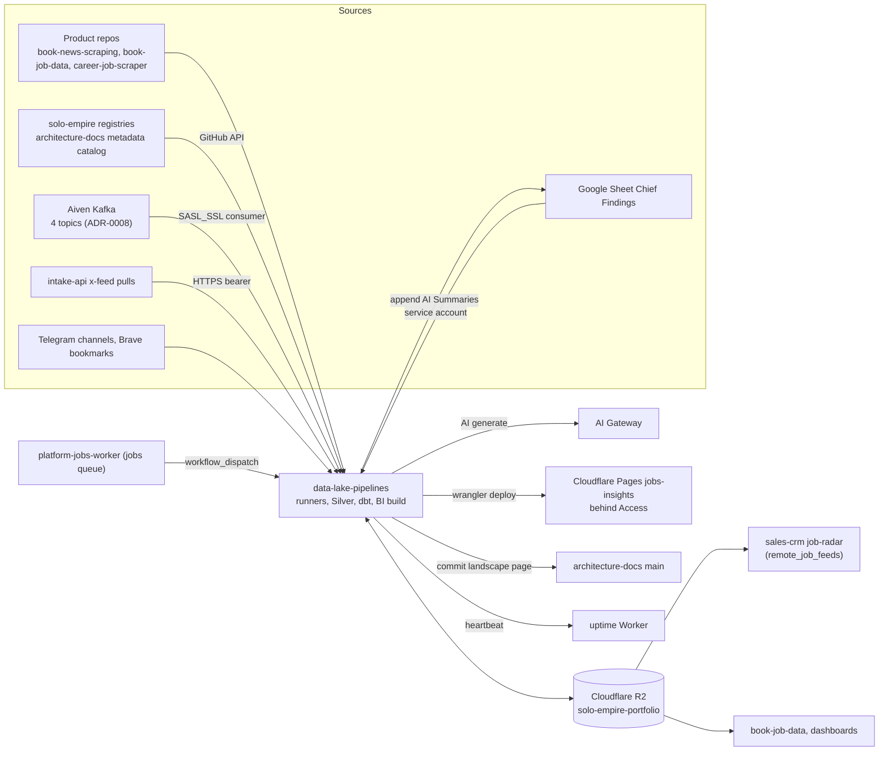
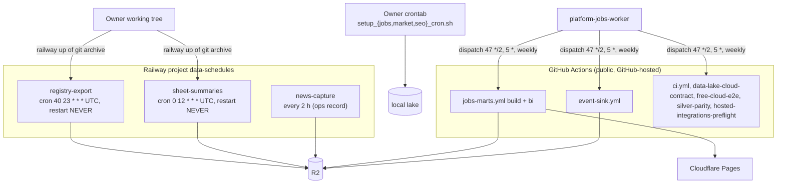

# solo-data-lake — System Architecture

เอกสารนี้อธิบาย repo `bookchaowalit/data-lake-pipelines` (system id `solo-data-lake`) จากโค้ดและ config ที่ `origin/main` `3c9cc2a` (2026-11-04)
สัญญาข้อมูลและนโยบายที่มีอยู่แล้วใน `systems/` ไม่เขียนซ้ำ แต่ลิงก์ไว้:

- [`systems/ai-data/cloud-data-lake-mvp.md`](../systems/ai-data/cloud-data-lake-mvp.md) — local กับ hosted target ของ lake contract เดียวกัน
- [`systems/architecture/data-product-portfolio.md`](../systems/architecture/data-product-portfolio.md) — ขอบเขต data product และ consumer
- [`systems/architecture/data-product-versioning-policy.md`](../systems/architecture/data-product-versioning-policy.md) + `data-product-contracts-v1..v4.yaml` — port map และ freeze v4
- `systems/architecture/{job,news,discovery}-data-contract-v1.yaml`, `scraping-contracts/` — สัญญาต่อ domain

ทั้งหมดเป็นสำเนาจาก architecture-docs `systems/` (README §Self-contained)

## 1. Architecture style และเหตุผล

**Lake-first medallion pipeline (landing → Bronze → Silver → Gold) บน object storage** ที่ประกอบด้วย batch job สั้นๆ หลายตัว ไม่มี service ที่รันตลอด

- ทุก ingest เขียน artifact ที่เปลี่ยนไม่ได้สามชิ้น: landing bytes ดิบ, Bronze Parquet envelope, control manifest แล้วผู้บริโภคค่อย project ต่อ (`ingest.py`, [ADR-0001](../docs/diagrams/08-adr/ADR-0001-lake-first-immutable-ingest.md))
- object storage คือ source of truth; DuckDB/dbt เป็นแค่ compute ที่โยนทิ้งหลังรัน (`jobs_marts.py`); Kafka เป็นแค่ replay buffer (`stream_sink.py`)
- runtime เป็น scheduled batch สามแบบ: Railway cron (registry-export, sheet-summaries, news-capture), GitHub Actions ที่ jobs queue เป็นผู้สั่ง (jobs-marts, event-sink, contract checks) และ crontab บนเครื่อง owner (`setup_*_cron.sh`) ([ADR-0003](../docs/diagrams/08-adr/ADR-0003-scheduled-batch-hosting.md))

เหตุผลที่เห็นได้: ต้นทุนใกล้ศูนย์ (plan jobs: "Running cost: $0"), replay และ audit ได้จาก bytes ดิบ, ใช้ contract เดียวทั้ง local `file://` และ R2 (`cloud-data-lake-mvp.md`)

## 2. Quality-attribute scenarios

| QA | Scenario | กลไก | หลักฐาน |
|---|---|---|---|
| Replayability | รัน ingest/marts ซ้ำบนข้อมูลเดิม → ไม่เขียนอะไรใหม่ | batch/run id อิงเนื้อหา (Bronze, model, เวอร์ชัน duckdb/pyarrow); object store ปฏิเสธการเขียนทับที่ต่างกัน | `jobs_marts.py`, `registry_lake_export.py`, `storage.py` (`head` ก่อน put) |
| Safety (cloud write) | test หรือ workflow รันโดยไม่ได้ตั้งใจเขียน R2 → ปฏิเสธ | `DATA_LAKE_CLOUD_WRITE_ENABLED=true` ต้องตั้งเอง; contract workflows "never write to the cloud" | `storage.py` `put_bytes`, `PRODUCT.md` |
| Data quality | Bronze jobs มีแถวเสีย → quarantine ≤ 2 % ไป `job_postings_rejects`; เกิน = fail ก่อนเขียน Silver | `silver.py` job.silver.v2 | `docs/plans/2026-11-02-jobs-silver-mart-bi.md` Task 1 |
| Correctness | Silver เป็น full snapshot → marts ใช้ part เดียวที่ manifest ระบุ ไม่ glob | `--vars jobs_silver_part` | `jobs_marts.py`, README §Jobs |
| Delivery (events) | sink ล้มกลางทาง → อ่านซ้ำได้ ไม่หาย | commit offset หลังเขียน Avro + manifest + checkpoint ครบ (at-least-once) | `stream_sink.py` |
| Observability | job ล้มหรือหยุดรัน → Telegram | heartbeat ไป uptime Worker (`registry-export` 26 ชม., `jobs-marts` 5 ชม., `event-sink` 3 ชม.); jobs queue retry + `jobs-dlq` | README, `aace807` |
| Confidentiality (public repo) | log ของ GitHub-hosted runner เป็น public → พิมพ์แค่จำนวน, stderr อยู่ใน temp file | workflow design | `jobs-marts.yml`, `event-sink.yml` (comment หัวไฟล์), `141d142` |
| Privacy (AI) | sheet-summaries ส่งแถวที่มีชื่อลูกค้า → ถูกตัดก่อนเรียก gateway; ไม่มี denylist = ไม่รัน | client denylist, JSON schema validation | `docs/sheet-summaries.md` |
| Privacy (errors) | runner ล้ม → Sentry ได้ข้อความคงที่ + type/frame เท่านั้น | allowlist scrubber | `observability.py`, `observability_test.py` |
| Concurrency | capture สองรอบชนกัน → รอบหลัง exit 2 (lock held) | `capture_lock.py` | `PRODUCT.md` §Observability |

## 3. Context diagram

ภาพ C4 แบบเต็ม: [05-c4-context.md](../docs/diagrams/05-c4-context.md), [06-c4-container.md](../docs/diagrams/06-c4-container.md)

## 4. Components / containers

| Component | หน้าที่ | หลักฐาน |
|---|---|---|
| Lake core (`ingest`, `storage`, `parquet`, `avro`, `iceberg`, `query`, `maintenance`) | เขียน landing/Bronze/manifest, object store `file://` หรือ S3 ผ่าน aws CLI, DuckDB query, Iceberg catalog helper, restore drill | `infra/scripts/data_lake/` |
| Silver / product store | transform Bronze → Silver ต่อ product contract, parity evidence | `silver.py`, `product_store.py`, `silver_parity_evidence.py` |
| Capture runners | `run_{jobs,market,seo,news}_capture.py`, `run_collection_monitor.py`, lock + timeout + retry | `run_*.py`, `capture_lock.py`, `setup_*_cron.sh` |
| Jobs marts + BI | Silver → dbt → Gold manifest; snapshot Gold → static HTML site | `jobs_marts.py`, `jobs_bi_snapshot.py`, `jobs_bi_site.py`, `infra/bi/jobs` |
| Event sink | Kafka → Avro landing → Bronze Parquet; heartbeat event e2e | `stream_sink.py`, `event_heartbeat.py` |
| Metadata export + landscape | registries/catalog → Bronze `domain=metadata`; render landscape page | `registry_lake_export.py`, `scheduled_registry_export.py`, `system_landscape.py` |
| Collectors / adapters | x-feed → `social/x_feed`, sheet summaries, Telegram, Brave, diary intake, discovery, opportunities | `infra/scripts/sync/`, `infra/scripts/cli/`, `infra/scripts/{discovery,opportunities}` |
| dbt project | staging (`stg_job_postings`, `stg_x_feed`, `stg_emails`), marts (`jobs`, `email_activity_daily`), metadata models | `infra/dbt/models/` |
| Vendored utils | สำเนา `_env`, `cell_store`, `task_store`, `secret_resolver`, `data_product_contract_guard` ฯลฯ | `infra/scripts/utils/` |

## 5. Tech stack

| ชั้น | เทคโนโลยี | หลักฐาน |
|---|---|---|
| ภาษา | Python ≥3.12 (CI 3.12; jobs-marts plan 3.13), uv lock | `pyproject.toml`, `uv.lock` |
| Storage format | Parquet (pyarrow ≥25), Avro (fastavro), Iceberg (pyiceberg sql-sqlite, s3fs) | `pyproject.toml` |
| Compute | DuckDB ≥1.5.5, dbt-duckdb ≥1.11, chDB/ClickHouse connect (multi-engine lab) | `pyproject.toml`, `engines/`, `multi_engine_lab.py` |
| Messaging | confluent-kafka ≥2.16 | `stream_sink.py` |
| Object store | Cloudflare R2 ผ่าน AWS CLI v1 | `storage.py`, `deploy/registry-export/Dockerfile` |
| BI | stdlib HTML + SVG, strict CSP, wrangler → Cloudflare Pages | `jobs_bi_site.py`, `3a0d5f8` |
| CI | shared `platform-ci-workflows` v1.1.1 (SHA pin), Ruff (pyflakes), mypy (scoped), GitHub-hosted runners | `.github/workflows/ci.yml` |
| Host | Railway cron (Dockerfile), GitHub Actions, owner crontab | `deploy/`, workflows, `setup_*_cron.sh` |

## 6. Data stores

| Store | Layout | ผู้เขียน | หลักฐาน |
|---|---|---|---|
| R2 `solo-empire-portfolio/portfolio-demo/book-job-data-001` | Bronze `job_postings`, Silver, Gold `gold/domain=jobs/...`, `control/manifests/gold/...`, stream `landing/stream/...`, `bronze/domain=<d>/...` | career-job-scraper, jobs-marts, event-sink | README §Jobs, §Event plane; `event-sink.yml` และ `jobs-marts.yml` ใช้ secret เดียวกัน `JOB_DATA_LAKE_URI` (ค่าจริง [ต้องยืนยัน]) |
| R2 `.../free-cloud-e2e-001` | `bronze/domain=metadata`, news, `income/remote_job_feeds` | registry-export, news-capture, sales-crm job-radar | README §Export อัตโนมัติ, plan Task 6 |
| Local lake `file://` + SQLite Iceberg catalog | สัญญาเดียวกับ hosted | dev, tests, owner crontab | `cloud-data-lake-mvp.md` |
| Scratch DuckDB | ทิ้งหลังรัน | jobs-marts | `jobs_marts.py` |
| `infra/database/` SQLite schema | ใช้กับ cell doubles ใน test เท่านั้น | tests | README §Self-contained |
| Google Sheet `AI Summaries` | append แถวสรุป; ไม่เขียน source tab | sheet-summaries | `docs/sheet-summaries.md` |

## 7. Integrations

| ระบบ | ทิศทาง | Auth (ชื่อตัวแปรเท่านั้น) | สถานะ |
|---|---|---|---|
| R2 | ↔ | `AWS_ACCESS_KEY_ID`, `AWS_SECRET_ACCESS_KEY`, `DATA_LAKE_S3_ENDPOINT`, `SOLO_EMPIRE_DATA_LAKE_URI`, GH secrets `JOB_DATA_*` | live |
| Aiven Kafka | consume / produce heartbeat | `STREAM_KAFKA_BOOTSTRAP`, `STREAM_KAFKA_CA_PEM`, SASL users `lake-sink`, `ops-heartbeat` | live 2026-11-04 (`54a5cb2`) |
| platform-jobs-worker | → `workflow_dispatch` | GitHub token ของ worker [ต้องยืนยัน] | live (`aace807`) |
| GitHub API | ← registries/catalog; → commit landscape | `GITHUB_TOKEN`, `LANDSCAPE_COMMIT_TOKEN` | live |
| intake-api x-feed | ← pulls, → mark exported | `EMPIRE_INTAKE_API`, `EMPIRE_TOKEN` | code merged `15a5e6f`; schedule [ต้องยืนยัน] |
| Google Sheets | ↔ | service account (extra `sheets`) | live 19:00 BKK |
| AI Gateway `api.bookchaowalit.com` | → `/api/ai/generate` route `sheet-summaries` | gateway token | live |
| Cloudflare Pages | → deploy | `CLOUDFLARE_PAGES_TOKEN`, `CLOUDFLARE_ACCOUNT_ID` | live `jobs-insights.pages.dev` |
| uptime Worker `monitor.bookchaowalit.com` | → heartbeat | `HEARTBEAT_TOKEN` | live |
| Sentry | → | `SENTRY_DSN` | opt-in |
| Product repos | ← อ่านจาก `$SOLO_BOOK_DEV_ROOT` | — | local; ไม่มี = skip |

## 8. Deployment topology

- Railway services deploy ด้วย CLI upload ของ `git archive <commit>`; Railway ปฏิเสธ `serviceConnect` repo นี้ จึงไม่มี push-to-deploy (`docs/sheet-summaries.md`, [ADR-0003](../docs/diagrams/08-adr/ADR-0003-scheduled-batch-hosting.md))
- image build รัน dry run บน fixture เป็น smoke test (`deploy/*/Dockerfile`)
- packaging ของ `news-capture` ไม่อยู่ใน repo นี้ (ดู Open questions ใน [06-c4-container.md](../docs/diagrams/06-c4-container.md))

## 9. ADR สำคัญ

| ID | การตัดสินใจ | ไฟล์ |
|---|---|---|
| ADR-0001 | Lake-first: ingest เขียน landing + Bronze + manifest แบบ immutable, consumer project ทีหลัง | [ADR-0001](../docs/diagrams/08-adr/ADR-0001-lake-first-immutable-ingest.md) |
| ADR-0002 | Object store เดียว (`file://` หรือ S3/R2 ผ่าน aws CLI) และ cloud write ปิดโดยปริยาย | [ADR-0002](../docs/diagrams/08-adr/ADR-0002-object-store-cloud-write-guard.md) |
| ADR-0003 | งานตามเวลาเป็น batch: Railway cron (CLI upload) และ GitHub Actions ที่ jobs queue สั่ง, ทุกงานมี heartbeat | [ADR-0003](../docs/diagrams/08-adr/ADR-0003-scheduled-batch-hosting.md) |
| ADR-0004 | Jobs medallion: Silver snapshot part เดียว → dbt-duckdb → Gold manifest, BI เป็น static site (แทน Evidence) | [ADR-0004](../docs/diagrams/08-adr/ADR-0004-jobs-medallion-dbt-static-bi.md) |
| ADR-0005 | Event plane sink: confluent-kafka, at-least-once, commit offset หลังเขียน lake | [ADR-0005](../docs/diagrams/08-adr/ADR-0005-kafka-sink-at-least-once.md) |
| ADR-0006 | แยก repo จาก solo-empire แบบ self-contained: คง `infra/...` layout และ vendor สำเนา | [ADR-0006](../docs/diagrams/08-adr/ADR-0006-self-contained-extraction.md) |

ADR ระดับ platform ที่ repo นี้ทำตาม: ADR-0004 (TDD + SDD), ADR-0007 (design floor ของ BI site), ADR-0008 (messaging layer) อยู่ใน architecture-docs

## 10. Fitness functions

| สิ่งที่ถูกเฝ้า | ตัวตรวจ | รันที่ |
|---|---|---|
| ทุก test ของ data lake ผ่าน, skip ที่ขึ้นกับ runtime กลายเป็น fail | `SOLO_EMPIRE_CI=1` + `infra/tests/data_lake/*_test.py` (51 ไฟล์) รวม `dbt_lake_test.py` (dbt build บน synthetic Bronze) | `ci.yml` |
| dependency ใน `pyproject.toml` ตรงกับ `infra/requirements-data-lake.txt` | `dependency_manifest_test.py` | `ci.yml` |
| type ของ `data_lake`, `discovery`, `opportunities`, `sheet_summaries` | `mypy` (scope ใน `[tool.mypy] files`) | `ci.yml` |
| contract v4 ของ data products | `data_product_contracts_v4_test.py`, `scraping_source_contract_test.py` | `ci.yml` |
| scheduler contract ของ jobs/news/market/seo | `*_scheduler_contract_test.py` | `ci.yml` |
| cloud contract โดยไม่เขียน cloud | `cloud_lake_contract_test.py` | `data-lake-cloud-contract.yml` (path filter + weekly) |
| e2e free cloud | `free_cloud_e2e_test.py` | `free-cloud-e2e.yml` |
| Silver parity กับ product repo | `silver_parity_evidence.py` | `silver-parity.yml` |
| Sentry scrubber | `observability_test.py` | `ci.yml` |
| capability mapping ใน landscape | dbt test `meta_system_landscape.capability_mapped` | `dbt build` |
| image ไม่พังก่อน deploy | dry run ใน Dockerfile | Railway build |
| ข้อมูลสด | heartbeat `registry-export`, `jobs-marts`, `event-sink` (+ `event-plane-e2e`) | uptime Worker |
| secret/dependency | shared `security.yml` v1.1.1 | `ci.yml` |

## 11. เอกสารลงรายละเอียด (SDLC phase 07)

docpack tier L0; มีงานใหม่หลัง 2026-10-16 (jobs marts, event sink, x-feed) จึงบันทึก gap ตาม doc-standard

| Template | สถานะ | ที่อยู่ / เหตุผล |
|---|---|---|
| infrastructure-and-network-design | missing | ส่วนหนึ่งอยู่ใน README §Export อัตโนมัติ และ `docs/sheet-summaries.md` |
| observability-design | partial | กลไก heartbeat/Sentry อยู่ใน README, `PRODUCT.md` §Observability; ไม่มี SLO |
| capacity-performance-and-cost-plan | partial | ต้นทุนและขนาดใน `docs/plans/2026-11-02-jobs-silver-mart-bi.md`; ปัญหา timeout news-capture 900 s (`product_adapter.py`, `5fb21c9`, `3c9cc2a`) |
| failure-mode-analysis | missing | — |
| async-integration-contract | partial | event plane ใน README §Event plane + architecture-docs ADR-0008; x-feed handshake ใน docstring `x_feed_lake_export.py` |
| frontend-architecture | partial | BI site: `jobs_bi_site.py`, `infra/bi/jobs/design-floor.json` |
| tech-debt-register | missing | หนี้ที่รู้: mypy gap ใน `utils`/`sync`, Ruff เฉพาะ pyflakes, ไม่มี format check, `data-lake-core` `check_parity.py` ยังชี้ path เก่า, `news_scheduler_contract_test` skip 2 test (README, `PRODUCT.md`) |
| system-landscape | done (generated) | repo นี้ render architecture-docs `operations/platform/SYSTEM-LANDSCAPE-GENERATED.md` เอง (`system_landscape.py`) |
| vendor-dependency-review | missing | vendor: Cloudflare (R2, Pages, Access), Railway, Aiven, Google, GitHub |
| data contracts (เพิ่มเติม) | done | [`systems/architecture/`](../systems/architecture/) |

## การอนุมัติ

| บทบาท | สถานะ | วันที่ | ลงนาม |
|---|---|---|---|
| Solution Architect (Book Dev) | รอตรวจ | — | [ต้องยืนยัน] |

## แหล่งข้อมูล

อ่านที่ `origin/main` `3c9cc2a` (ไม่ใช่ branch `feat/x-feed-lake-export` ของ checkout หลัก):

- `README.md`, `PRODUCT.md`, `DOCPACK/00-product-card.md`, `DOCPACK/docpack.yaml`, `pyproject.toml`
- `systems/ai-data/cloud-data-lake-mvp.md`, `systems/architecture/data-product-portfolio.md`, `systems/architecture/data-product-versioning-policy.md`
- `infra/scripts/data_lake/{ingest,storage,jobs_marts,stream_sink,run_news_capture,capture_lock,product_adapter}.py`, `infra/scripts/sync/x_feed_lake_export.py`
- `infra/dbt/models/`, `infra/tests/data_lake/` (รายชื่อไฟล์)
- `deploy/registry-export/Dockerfile`, `deploy/sheet-summaries/Dockerfile`, `docs/sheet-summaries.md`, `docs/plans/2026-11-02-jobs-silver-mart-bi.md`
- `.github/workflows/{ci,data-lake-cloud-contract,event-sink,free-cloud-e2e,hosted-integrations-preflight,jobs-marts,silver-parity}.yml`
- `git log` (commits `3a0d5f8`, `aace807`, `54a5cb2`, `15a5e6f`, `6115fdd`, `ba98f09`, `3296a5d`, `d7ddc9d`, `5fb21c9`, `141d142`, `3c9cc2a`)
