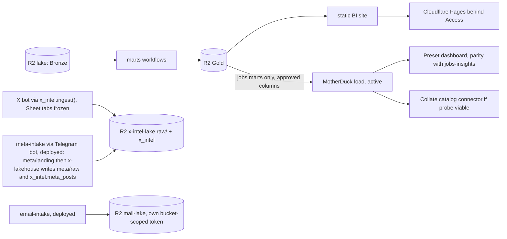

# 01 — Business process (As-Is / To-Be)

data-lake-pipelines คือ pipeline ของ lake-first data products ของ owner: เก็บข้อมูลจากหลายแหล่ง (งาน jobs, event จาก Kafka, open feeds, news, X, registry) ลง R2 ชั้น Bronze แล้วสร้าง Silver/Gold ด้วย dbt-duckdb และเผยแพร่เป็นหน้า BI บน Cloudflare Pages (หลัง Access) ผู้ใช้คือ owner และ data products ของ owner; ทุกงานเป็น batch ไม่มี service ที่รันค้าง และตั้งเวลาผ่าน job queue ของ platform-jobs-worker หรือ Railway cron

Last reviewed: 2026-11-27 · commit `28bd985`

## As-Is (จากโค้ดวันนี้)

```mermaid
flowchart LR
  JQ["platform-jobs-worker queue, workflow_dispatch"] --> CAP["collect workflows: open-feeds :25, github-activity, hf-trending, wiki-pageviews"]
  KAFKA["Kafka topics from service outboxes (commerce, platform, data.ingest, ops, finance)"] --> SINK["event-sink hourly :05: Avro landing, commit after write, convert"]
  JQ --> SINK
  TRB["career-job-scraper Track B every 6 h"] --> BRONZE
  NEWS["news-capture, Railway cron every 2 h"] --> BRONZE
  XL["x-lakehouse, Railway cron 3 times a day: inbox"] --> XLAKE[("R2 x-intel-lake raw/ + Supabase x_intel curated tables, not the marts Bronze")]
  CAP --> BRONZE[("R2 lake: Bronze Parquet + manifests")]
  SINK --> BRONZE
  BRONZE --> MARTS["marts workflows via queue: jobs 47 */2, news 35 */2, sales 20 *"]
  JQ --> MARTS
  MARTS --> GATE{"quality checks pass? jobs/news Silver: at most 2 percent invalid (sales reads Bronze directly)"}
  GATE -->|"no (build error)"| FAIL["workflow fails; heartbeat step sends ok:false with the cause, no heartbeat at all means uptime Worker alerts"]
  GATE -->|"yes, or stale / rejects (exit 3, still published, heartbeat ok:false)"| GOLD[("R2 Gold marts + Gold manifest")]
  GOLD --> BI["BI snapshot + static site, deploy when gold_run_id@commit is not live or on manual dispatch"]
  BI --> PAGES["Cloudflare Pages behind Access: jobs, news, revenue insights"]
  GOLD -.->|"needs MOTHERDUCK_TOKEN, else skipped_no_token"| MD["MotherDuck load, jobs marts only"]
  REG["registry-export daily, Railway cron"] --> BRONZE
  SHEETS["sheet-summaries daily, Railway cron: Google Sheets via AI Gateway"] --> SUMTABS["AI Summaries tabs in the sheet, not Bronze"]
  OWNER["owner machine: local crons and CLIs, cloud write needs explicit approval env"] -.-> BRONZE
```

Sources: `README.md`, `.github/workflows/{event-sink,jobs-marts,news-marts,sales-marts,open-feeds,github-activity,hf-trending,wiki-pageviews}.yml`, `infra/scripts/data_lake/{stream_sink,jobs_marts,news_marts,sales_marts,motherduck_load,open_feeds,scheduled_registry_export}.py`, `infra/scripts/x_lakehouse/scheduled.py`, `deploy/`, `docs/diagrams/06-c4-container.md`, `docs/specs/*.md`

ข้อเท็จจริงสำคัญจากโค้ดและเอกสาร:

- `jobs-marts` ใช้ `dagster_jobs.py` (asset checks) → `jobs_marts.py` → dbt; ถ้า dispatch ด้วย `source=jobs-queue` จะไม่ force deploy BI
- event-sink commit offset หลังเขียน lake ครบเท่านั้น (at-least-once, ADR-0005)
- news-capture: repo นี้มี runner (`run_news_capture.py`) แต่ไม่พบ Dockerfile/Railway config ของ service; commit ที่ live [ต้องยืนยัน]
- crontab บนเครื่อง owner (`setup_*_cron.sh` ของ jobs/market/seo) ยังเปิดอยู่หรือไม่ [ต้องยืนยัน]
- x-lakehouse (Railway `data-schedules`) deploy ด้วย `railway up` โดย owner; สถานะ migration `x-lake-private-datasets` ใน production [ต้องยืนยัน]
- `README.md`/`PRODUCT.md` ส่วนหนึ่งเขียนไว้ 2026-10-23 (PRODUCT.md ว่า "ไม่มี hosted runtime") ขัดกับ workflows ปัจจุบัน (ดู G6)

## To-Be (จาก ADR-0016, specs และ plans ใน `docs/`)

Sources: `docs/specs/jobs-motherduck-load.md`, `docs/specs/jobs-preset-dashboard.md`, `docs/specs/jobs-collate-connector-test.md` (ADR-0016 P2-P4), `docs/plans/2026-11-10-x-sheet-cutover-runbook.md`, `docs/specs/email-intake.md`, `docs/specs/meta-intake.md`

## Gap

| ID | As-Is → To-Be | Status | Owner | Evidence |
|---|---|---|---|---|
| G1 | MotherDuck load ข้ามเพราะไม่มี `MOTHERDUCK_TOKEN` → โหลด Gold jobs marts เข้า MotherDuck ทุกรอบ | blocked | owner | `docs/specs/jobs-motherduck-load.md` (รอ owner สมัคร, ADR-0016 O2) |
| G2 | ไม่มี dashboard บน Preset → dashboard จาก `infra/bi/preset/jobs/datasets/` และ parity กับ jobs-insights | blocked | owner | `docs/specs/jobs-preset-dashboard.md` (รอ O2 และ Preset sign-up O3) |
| G3 | Collate probe ยังรัน endpoint ไม่ได้ → ได้ `viable` true/false เพื่อปิด P4 | blocked | owner | `docs/specs/jobs-collate-connector-test.md` |
| G4 | บอท X ยังเขียน X Sheet tabs → ย้ายการเขียนไป lake อย่างเดียว (cutover step 1 และ 3) | decide | owner | `docs/plans/2026-11-10-x-sheet-cutover-runbook.md` (step 1 open; step 3 บันทึก 11-14 ใน runbook [ต้องยืนยัน]) |
| G5 | email-intake และ meta-intake: spec approved, meta v1 ปิดจนกว่าจะ deploy (`X_LAKE_META`) → deploy และเปิด | decide | owner | `docs/specs/email-intake.md`; `docs/specs/meta-intake.md` |
| G6 | `PRODUCT.md` (2026-10-23) ระบุไม่มี hosted runtime, schedule เป็นแค่ contract → อัปเดตให้ตรง workflows และ Railway cron ปัจจุบัน | todo | claude | `PRODUCT.md` §Limits; `.github/workflows/*.yml` |
| G7 | news-capture ไม่มี Dockerfile/Railway config ใน repo → config อยู่ใน repo หรือบันทึก commit ที่ live | todo | claude | `docs/diagrams/06-c4-container.md` §Open questions |
| G8 | mypy ไม่ครอบ `infra/scripts/utils`, `sync`, `cli` และ ruff ใช้ชุดกฎแคบ → ขยายตามที่บันทึกไว้ | todo | claude | `PRODUCT.md` §Limits |

## Open questions

- crontab ของ jobs/market/seo บนเครื่อง owner ยังเปิดอยู่หรือไม่ หลัง jobs ย้ายไป Track B
- migration `x_intel` ตาม `x-lake-private-datasets` ถูก apply ใน production แล้วหรือไม่
- ระบบอื่นที่ repo นี้ถือสเปก (consumer `data-lake-core`, `event-hub`) ไม่ได้อยู่ในไฟล์นี้
