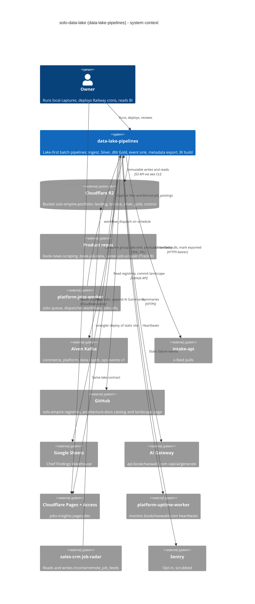

# 05 — C4 Context

Sources: `README.md`, `PRODUCT.md`, `docs/sheet-summaries.md`, `docs/plans/2026-11-02-jobs-silver-mart-bi.md`, `infra/scripts/data_lake/{storage,stream_sink,scheduled_registry_export,jobs_marts}.py`, `infra/scripts/sync/x_feed_lake_export.py`, `.github/workflows/{jobs-marts,event-sink}.yml` (ที่ `3c9cc2a`)

ภาพรวมระดับ platform อยู่ใน architecture-docs (`docs/architecture/C4-DIAGRAMS.md`, `operations/platform/SYSTEM-LANDSCAPE-GENERATED.md` ที่ repo นี้ generate)

## Open questions

- `x_feed_lake_export.py` (merge `15a5e6f` 2026-11-04) ยังไม่มี schedule ใน repo: จะรันจาก Railway, jobs queue หรือเครื่อง owner
- Telegram channel / Brave bookmark collectors และ diary intake รันที่ไหนและเขียน lake ใด: repo ไม่มี scheduler ของมัน
- consumer อื่นของ Gold jobs นอกจาก BI site มีหรือไม่ (`book-job-data` API อ่าน Silver/Gold?)
