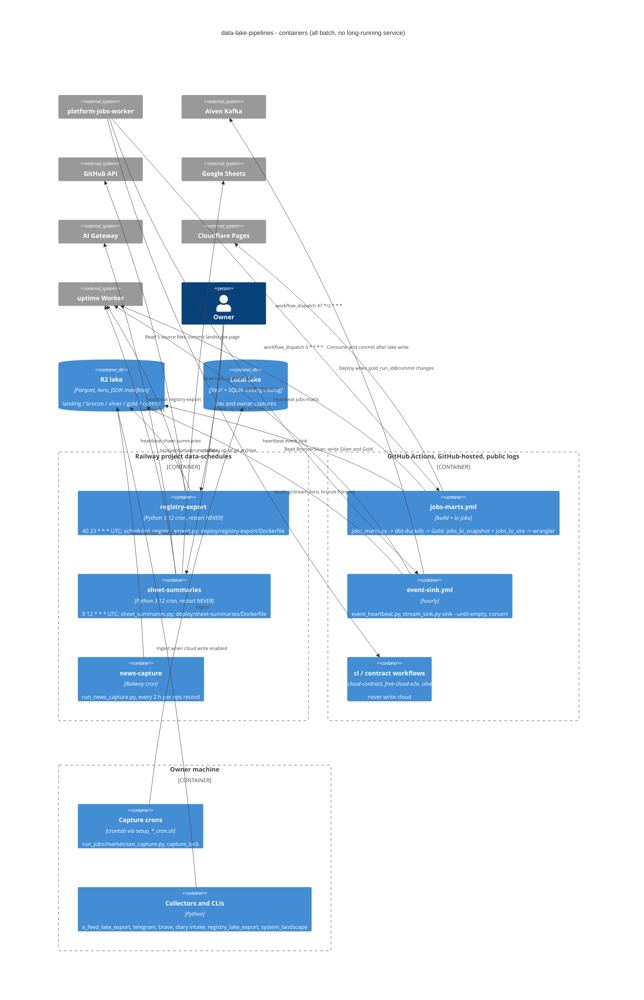

# 06 — C4 Container

Sources: `deploy/registry-export/Dockerfile`, `deploy/sheet-summaries/Dockerfile`, `docs/sheet-summaries.md`, `README.md` (§Jobs, §Event plane, §Export อัตโนมัติ), `.github/workflows/*.yml`, `infra/scripts/data_lake/{setup_jobs_cron.sh,capture_lock.py,storage.py,run_news_capture.py}`, `infra/scripts/sync/x_feed_lake_export.py` (ที่ `3c9cc2a`)

## Open questions

- `news-capture`: repo นี้มี runner (`run_news_capture.py`) แต่ไม่มี Dockerfile/Railway config ของ service; image สร้างจากไหนและ commit ไหน live (ops record: CLI deploy lake#16, 2026-10-28; `3c9cc2a` แก้ health check 2026-11-04 ยังไม่ทราบว่า deploy แล้วหรือไม่)
- crontab ของ jobs/market/seo บนเครื่อง owner ยังเปิดอยู่หรือไม่ หลัง jobs ย้ายไป Track B บน GitHub Actions
- heartbeat `sheet-summaries` ต้องมี entry ใน uptime Worker ก่อนจะ alert (`docs/sheet-summaries.md`): มีแล้วหรือยัง
